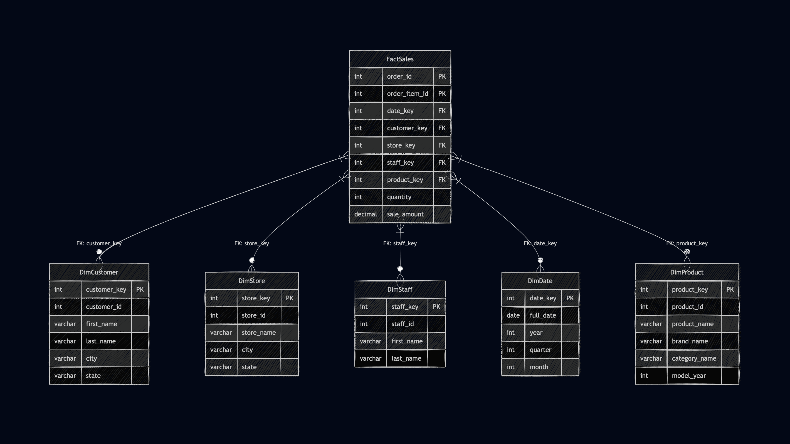

# OLAP Data Warehouse & Iceberg Cubing Analytics Suite

**End-to-end analytical engineering project combining a DuckDB Star Schema retail data warehouse with a modular Python data mining engine for Attribute-Oriented Induction (AOI) and Bottom-Up Cubing (BUC).**

`Python 3.10+` · `DuckDB` · `SQL OLAP` · `Iceberg Cubing` · `GitHub Actions CI` · `GitHub Pages` · `MIT License`

## Overview

Modern analytical platforms rely on two complementary pillars: **structured OLAP data warehouses** for multidimensional business intelligence, and **algorithmic pattern mining** for iceberg cubing and high-level concept summarization.

This repository brings both together in a clean, modular, reproducible architecture:

1. **Module 1 — Retail Star Schema & OLAP Warehouse (`src/warehouse/`):**
   - Designs and populates a **5-dimension Star Schema** (`FactSales`, `DimDate`, `DimCustomer`, `DimStore`, `DimStaff`, `DimProduct`) in **DuckDB** from nine normalized retail CSV feeds.
   - Executes 8 multidimensional OLAP queries utilizing `ROLLUP`, `CUBE`, and analytical window functions (`ROW_NUMBER`, `RANK`) across 4,722 order-line transactions ($7.69M net revenue).
2. **Module 2 — Attribute-Oriented Induction & Iceberg Cubing Engine (`src/mining/`):**
   - Implements **Attribute-Oriented Induction (AOI)** concept hierarchies to extract characteristic rules across 10,000 marketing campaigns.
   - Implements four **Bottom-Up Cube (BUC)** variants — **In-Memory BUC**, **Simulated Out-of-Memory Paged BUC**, **Apriori-Pruned BUC**, and **Cardinality-Sorted Iceberg BUC** — with automated equivalence tests and runtime benchmarking.
3. **Interactive GitHub Pages Dashboard & CI Automation (`docs/` & `.github/workflows/`):**
   - Runs directly on GitHub via **GitHub Actions CI** (automated unit/integration tests + full DuckDB/Python pipeline verification) and deploys an interactive **GitHub Pages** dashboard (`docs/index.html`) featuring real-time BUC iceberg cube filtering.

## Star Schema Architecture



| Table | Role | Row Count | Key Design Notes |
| :--- | :--- | ---: | :--- |
| `FactSales` | Fact Table | 4,722 | Order-line grain with computed `sale_amount` & `discount_amount` |
| `DimDate` | Dimension | 1,096 | Generated calendar dimension (2016-01-01 to 2018-12-31) |
| `DimCustomer` | Dimension | 1,445 | Customer demographics & geographic attributes |
| `DimProduct` | Dimension | 321 | Denormalized join of `products`, `brands`, and `categories` |
| `DimStaff` | Dimension | 10 | Sales personnel dimension |
| `DimStore` | Dimension | 3 | Retail storefront locations |

## Headline Insights

### Retail Warehouse OLAP Findings
- **2018 Revenue Anomaly:** Annual net revenue grew **42.0%** from **$2.43M (2016)** to **$3.45M (2017)** before dropping to **$1.81M (2018)** — with **April 2018 alone generating $817,921.28 (45.1% of the year's total)**.
- **Store & Staff Concentration:** **Baldwin Bikes** drives **$5.22M (67.83%)** of company revenue, with top performer **Marcelene Boyer** accounting for over **$2.62M (~34%)**.
- **Category Dominance:** **Mountain Bikes ($2.72M)** and **Road Bikes ($1.67M)** represent **57.0%** of total sales, led by **Trek** in performance categories and **Electra** in lifestyle/cruiser segments.
- **High-Value Customers:** Top VIP buyers led by **Sharyn Hopkins ($34,807.93)** and **Pamelia Newman ($33,634.24)**.

Full executive report: [`docs/warehouse_report.md`](docs/warehouse_report.md)

### AOI & Iceberg Cubing (BUC) Findings
- **AOI Characteristic Rules:** Generalizing `Budget` and `Revenue_Generated` across 10,000 campaigns reveals `(Budget=Medium, Revenue=Medium)` as the dominant profile (**2,091 records / 20.91%**), followed by `(Budget=High, Revenue=Medium)` (**2,023 records / 20.23%**).
- **BUC Pruning & Scalability:** Increasing `minsup` from `50` to `1500` prunes frequent cuboids from **63 down to 14** and reduces runtime monotonically.
- **Exact Equivalence Verified:** All four BUC implementations (`buc_in_memory`, `buc_paged`, `buc_apriori_pruned`, `buc_iceberg_sorted`) are unit-tested to produce identical canonical iceberg cubes.

Full technical report: [`docs/mining_report.md`](docs/mining_report.md)

## Project Structure

```text
olap-warehouse-iceberg-cubing/
├── .github/workflows/
│   ├── ci.yml                       # Automated CI running tests & full OLAP/BUC pipeline
│   └── pages.yml                    # Automated GitHub Pages deployment for interactive dashboard
├── assets/
│   └── er_diagram.png               # Star Schema ER diagram
├── data/
│   ├── retail/                      # 9 normalized retail CSV feeds (orders, products, stores, etc.)
│   └── marketing/
│       └── marketing_campaigns.csv  # 10,000-row marketing campaign dataset
├── docs/
│   ├── index.html                   # Interactive GitHub Pages analytics dashboard
│   ├── dashboard_data.json          # Live-exported verified metrics for the dashboard
│   ├── warehouse_report.md          # Executive Star Schema & OLAP analysis report
│   └── mining_report.md             # Technical AOI & BUC iceberg cubing report
├── notebooks/
│   └── iceberg_cubing_and_aoi.ipynb # Exploratory Jupyter notebook with visualizations
├── src/
│   ├── warehouse/
│   │   ├── runner.py                # DuckDB ETL & OLAP pipeline orchestrator
│   │   └── sql/
│   │       ├── 01_schema.sql        # Star Schema DDL
│   │       ├── 02_etl_load.sql      # ETL transformation & loading script
│   │       ├── 03_olap_queries.sql  # 8 ROLLUP, CUBE & window-function OLAP queries
│   │       └── 04_verification.sql  # KPI & anomaly verification queries
│   └── mining/
│       ├── aoi.py                   # Attribute-Oriented Induction engine
│       ├── buc.py                   # In-Memory, Paged, Apriori & Cardinality-Sorted BUC
│       ├── benchmark.py             # Parameter sweep & variant benchmarking suite
│       └── cli.py                   # Mining CLI entry point
├── tests/
│   ├── test_warehouse.py            # DuckDB Star Schema & OLAP integration tests
│   └── test_mining.py               # AOI & BUC equivalence and monotonicity unit tests
├── main.py                          # Unified CLI entry point
├── requirements.txt                 # Optional DuckDB Python bindings & plotting dependencies
└── LICENSE                          # MIT License
```

## Quickstart

### 1. Install Dependencies
```bash
pip install -r requirements.txt
```
*(Core CLI execution also works out-of-the-box with Python 3.10+ standard library + the `duckdb` CLI binary.)*

### 2. Run the Unified Pipeline
```bash
# Execute both the DuckDB Star Schema OLAP suite and the AOI/BUC mining benchmarks
python3 main.py --all

# Run individual modules
python3 main.py --warehouse
python3 main.py --mining

# Regenerate verified JSON/JS data for the interactive GitHub Pages dashboard
python3 main.py --export-dashboard-data
```

### 3. Run the Test Suite
```bash
python3 -m unittest discover -s tests -v
```

## Running on GitHub

- **Interactive Web Dashboard (GitHub Pages):** Once GitHub Pages is enabled (Source: **GitHub Actions**), `.github/workflows/pages.yml` automatically deploys `docs/index.html`, letting visitors interactively inspect revenue trends, the AOI heatmap, BUC benchmarks, and a live `minsup` iceberg cube explorer right in the browser.
- **Automated Pipeline Verification (GitHub Actions):** Every push or manual dispatch triggers `.github/workflows/ci.yml`, executing all 8 unit/integration tests and the full DuckDB + Python pipeline on Ubuntu runners.

## Author & License

**Rajath Gadagkar** — `rajathgadagkar@gmail.com`

Licensed under the [MIT License](LICENSE) — Copyright (c) 2025-2026 Rajath Gadagkar.
