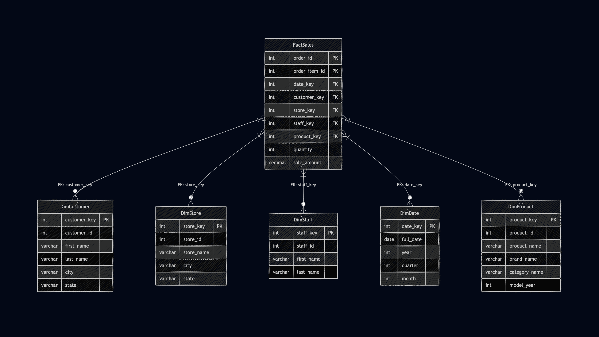

# Retail Data Warehouse & OLAP Sales Analysis Report

**Author:** Rajath Gadagkar

## 1. Executive Summary

This report documents the architecture, ETL pipeline, and multidimensional OLAP analysis of a retail bicycle sales data warehouse built on **DuckDB**. Consolidating nine normalized transactional CSV feeds into an analytical **Star Schema** (`FactSales` + 5 conformed dimensions) enables sub-second `ROLLUP`, `CUBE`, and window-function queries across 4,722 order-line transactions spanning 2016–2018 ($7.69M total net revenue).

Headline findings:
- **2018 Revenue Cliff & April Anomaly:** Net revenue grew **42.0%** from **$2.43M** in 2016 to **$3.45M** in 2017, before dropping **47.4%** to **$1.81M** in 2018. Nearly half (**45.1%**) of all 2018 revenue occurred in a single anomalous spike during **April 2018 ($817,921.28)**, followed by a sharp drop-off across the remainder of the year.
- **Store & Personnel Concentration Risk:** **Baldwin Bikes** generates **$5.22M (67.83%)** of total company revenue, and its top sales representative, **Marcelene Boyer**, accounts for over **$2.62M (~34%)** of company-wide sales.
- **Category & Brand Leadership:** **Mountain Bikes ($2.72M)** and **Road Bikes ($1.67M)** together drive **57.0%** of total revenue, led predominantly by **Trek**, while **Electra** leads the Cruisers and Children Bicycles segments.

## 2. Star Schema & ETL Architecture

### Extract, Transform, Load (ETL)
1. **Extract:** Reads nine raw transactional CSV sources (`orders`, `order_items`, `customers`, `products`, `brands`, `categories`, `stores`, `staffs`, `stocks`).
2. **Transform:**
   - Denormalizes `products`, `brands`, and `categories` into a single `DimProduct` dimension (321 rows) to eliminate snowflake joins at query time.
   - Generates a complete calendar table `DimDate` (1,096 days from `2016-01-01` to `2018-12-31`) with `year`, `quarter`, `month`, `month_name`, and `day_of_week`.
   - Computes line-item net revenue `quantity * list_price * (1 - discount)` and `discount_amount` inside `FactSales` (4,722 rows).
3. **Load:** Populates dimension tables first to guarantee referential integrity, followed by `FactSales` referencing all five surrogate keys.

## 3. Key Analytical Findings

| Metric | Finding | Business Implication |
| :--- | :--- | :--- |
| **Annual Revenue** | 2016: $2,427,376.17 · 2017: $3,447,205.06 · 2018: $1,814,528.48 | Investigate the April 2018 ($817,921.28) spike and post-April collapse. |
| **Top Categories** | Mountain Bikes ($2.72M) & Road Bikes ($1.67M) | Over 57% of revenue comes from two performance cycling categories. |
| **Top Store** | Baldwin Bikes: $5,215,746.64 (67.83% share) | High geographic concentration; replicate store playbook at Santa Cruz (20.88%) & Rowlett (11.28%). |
| **Top Customers** | Sharyn Hopkins ($34,807.93), Pamelia Newman ($33,634.24) | Ideal cohort for VIP loyalty and retention incentives. |

## 4. Strategic Recommendations

1. **Audit the April 2018 Revenue Anomaly:** Inspect order logs, bulk B2B invoices, and inventory records from Q2 2018 to isolate whether the spike reflects a one-off wholesale order or a data pipeline cutoff.
2. **Codify the Baldwin Bikes Playbook:** Document sales processes and local marketing practices at Baldwin Bikes and cross-train teams at Santa Cruz Bikes and Rowlett Bikes to reduce single-location dependency.
3. **Launch a Tiered VIP Loyalty Program:** Prioritize retention offers and early product access for the top 5 high-value customers (each spending >$31,900).
4. **Align Inventory with Core Profit Drivers:** Concentrate working capital and promotional spend around high-margin **Trek** Mountain/Road models and **Electra** lifestyle cruisers.
